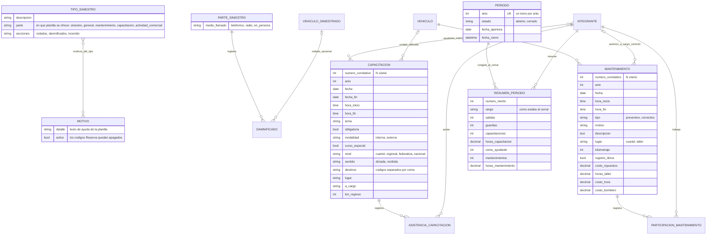

# Sistema de Gestión Interna — Cuerpo de Bomberos Voluntarios de Villa María

> Documento de contexto completo para continuar el desarrollo con asistencia de IA.
> Última actualización: a partir de la conversación de relevamiento + revisiones del tutor externo.
> Autor del proyecto: Franco Ferraro (pasantía — Ingeniería en Sistemas).

---

## 1. Qué es esto y por qué existe

Trabajo de pasantía: un sistema de gestión interna para el Cuerpo de Bomberos Voluntarios de Villa María,
documentado originalmente como SRS (Especificación de Requisitos de Software) bajo ISO/IEC/IEEE 29148.

- **Cliente real:** el cuartel de bomberos.
- **Tutor externo:** revisa decisiones técnicas antes de avanzar, no programa.
- **El SRS relevó 6 procesos en papel**, pero **el MVP cubre solo uno: el Parte de Siniestro**
  (equivalente a RF-01 a RF-15 del SRS original). Los otros cinco (mantenimiento de vehículos,
  capacitación, negativa a atención como módulo independiente, inscripción a cursos especiales,
  itinerario de viaje) quedan documentados para Fase 2, no se implementan ahora.
- **Fecha límite del MVP:** antes de diciembre de 2026.
- **Sin presupuesto** para infraestructura paga (restricción de diseño explícita del SRS).

---

## 2. Cómo operan en la realidad (esto definió gran parte del diseño)

No es "se completa un formulario y listo". Es un proceso en dos tiempos, con personas distintas:

1. **Llega el llamado.** Lo atiende el **guardia de turno** (o personal de E-100) desde el cuartel,
   con conexión asegurada. Se cargan ahí los datos generales: fecha, teléfono de origen, hora de
   llamada, quién autoriza, tipo/motivo, ubicación. Se asigna un número de control correlativo
   **por año** (ej. 1425/2026), automático y no editable.
2. **El móvil sale (o no).** Es común que se prepare la salida y se cancele a último momento — los
   horarios de salida/llegada/regreso y el kilometraje no pueden ser obligatorios de forma rígida.
3. **Los bomberos que van completan el resto en el lugar del siniestro, desde el celular**: vehículos
   involucrados, damnificados con su triage, entidades que intervinieron (puede ser más de una:
   policía, tránsito, forense, juzgado, gendarmería, fiscalía, guardia local), fotos del hecho, y
   quiénes concurrieron. **Confirmado por el cliente: a veces no hay señal en absoluto** en el lugar
   del siniestro — la carga ahí tiene que funcionar offline y sincronizar después.
4. Al cargar personal que concurrió, normalmente se pide **el número** de cada bombero (no el nombre),
   porque así está en el papel. Ese número (101-299) es un **"número de mérito"** que **cambia cada
   año** según el escalafón — no es un identificador fijo de la persona.
5. **Los registros físicos se llevan en tomos anuales.** Al cliente le interesan métricas/resumen
   de participación de bomberos **por año**, para planificar el año siguiente (ej. qué capacitaciones
   dar según los tipos de siniestro más frecuentes). Esto es un requisito real, no solo "lindo tenerlo".

---

## 3. Decisiones de arquitectura (y por qué)

| Decisión | Por qué |
|---|---|
| **Backend:** Django (Python) | El desarrollador sabe programar pero nunca hizo web. Django tiene curva de aprendizaje baja, ORM que refleja el DER 1 a 1, admin panel y sistema de auth/permisos incluidos gratis. Python además es el lenguaje con mejor proyección fuera de lo puramente web (data, automatización), buena apuesta para el perfil junior. |
| **Base de datos (dev):** SQLite | Cero instalación, viene con Django, ideal para desarrollar en la máquina local sin fricción. |
| **Base de datos (producción):** PostgreSQL | Django permite el cambio sin tocar los modelos. Se migra recién al momento del deploy. |
| **Hosting:** capa gratuita (Render o similar) | Cumple la restricción de "sin presupuesto" del SRS (RD-02). |
| **Frontend (MVP):** templates de Django + HTML/CSS simple, sin framework JS | Minimiza conceptos nuevos a la vez. Nada de React/Vue todavía. |
| **Offline (carga en el lugar del siniestro):** IDs tipo UUID generados en el dispositivo + bandera `sincronizado` + `fecha_captura_local` | Si dos celulares cargan datos sin señal al mismo tiempo, no pueden coordinarse para numerar filas sin chocar. Un UUID generado localmente nunca choca entre dispositivos. |

---

## 4. Modelo de datos — DER completo (objetivo final)

Este es el diagrama completo al que apunta el sistema. **OJO: todavía no está todo implementado en
código** — ver sección 6 para el subconjunto real ya construido.

```mermaid
erDiagram

    RANGO ||--o{ INTEGRANTE : posee
    ESTADO_INTEGRANTE ||--o{ INTEGRANTE : posee
    RANGO ||--o{ NUMERO_MERITO : "vigente_ese_anio"
    INTEGRANTE ||--o{ NUMERO_MERITO : "tiene_por_anio"
    INTEGRANTE ||--o| PERSONAL_E100 : puede_ser
    INTEGRANTE ||--o{ PARTE_SINIESTRO : "es_guardia"
    INTEGRANTE ||--o{ PARTE_SINIESTRO : "autorizo"
    INTEGRANTE ||--o{ PARTE_SINIESTRO : "cerro"
    ESTADO_PARTE ||--o{ PARTE_SINIESTRO : "define_estado"
    PERSONAL_E100 ||--o{ PARTE_SINIESTRO : "recibio_llamada"
    TIPO_SINIESTRO ||--o{ PARTE_SINIESTRO : clasifica
    MOTIVO ||--o{ PARTE_SINIESTRO : clasifica
    TIPO_VEHICULO ||--o{ VEHICULO : clasifica
    COMBUSTIBLE ||--o{ VEHICULO : usa
    VEHICULO ||--o{ PARTE_SINIESTRO : "unidad_utilizada"
    PARTE_SINIESTRO ||--o{ VEHICULO_SINIESTRADO : involucra
    PARTE_SINIESTRO ||--o{ PARTE_FOTO : documenta
    VEHICULO_SINIESTRADO ||--o{ DAMNIFICADO : tiene
    PARTE_SINIESTRO ||--o| INCENDIO_DATO : "puede_generar"
    TIPO_ENTIDAD ||--o{ ENTIDAD_INTERVINO : clasifica
    PARTE_SINIESTRO ||--o{ ENTIDAD_INTERVINO : registra
    PARTE_SINIESTRO ||--o{ PARTE_PERSONAL : convoca
    INTEGRANTE ||--o{ PARTE_PERSONAL : participa
    PARTE_SINIESTRO ||--o{ NEGATIVA_ATENCION : "puede_generar"
    DAMNIFICADO ||--o| NEGATIVA_ATENCION : firma

    RANGO {
        int id_rango PK
        string nombre_rango
        int orden_jerarquico
    }

    ESTADO_INTEGRANTE {
        int id_estado PK
        string nombre_estado "Activo, Aspirante, Retirado, Reserva, Auxiliar"
    }

    ESTADO_PARTE {
        int id_estado_parte PK
        string nombre_estado "Iniciado, En curso, Cerrado"
    }

    INTEGRANTE {
        int id_integrante PK
        string legajo UK "identificador permanente"
        string apellido
        string nombre
        string dni
        date fecha_nacimiento
        string domicilio
        string localidad
        string telefono
        string email
        string sexo
        float altura
        float peso
        string grupo_sanguineo
        string factor_rh
        bool donante_sangre
        string nivel_educativo
        string titulo_obtenido
        string foto
        int id_rango FK
        int id_estado FK
        date fecha_ingreso
        date fecha_ultimo_ascenso
        bool es_jefe_activo
        bool instructor_cuartel
        bool instructor_regional
        bool instructor_federacion
    }

    NUMERO_MERITO {
        int id_escalafon PK
        int id_integrante FK
        int anio
        int numero_merito "101-299, cambia cada anio"
        int id_rango FK "rango vigente ese anio"
    }

    PERSONAL_E100 {
        int id_e100 PK
        int id_integrante FK
        date fecha_asignacion
        bool activo
    }

    TIPO_VEHICULO {
        int id_tipo_vehiculo PK
        string descripcion
    }

    COMBUSTIBLE {
        int id_combustible PK
        string descripcion "Gas Oil, Nafta, GNC"
    }

    VEHICULO {
        int id_vehiculo PK
        string legajo UK
        int id_tipo_vehiculo FK
        string marca
        string modelo
        string patente
        int anio
        date fecha_adquisicion
        int id_combustible FK
        int kilometraje_actual
        date fecha_vto_verificacion
        bool es_propiedad_cuerpo
        bool en_servicio
        bool dado_de_baja
    }

    TIPO_SINIESTRO {
        int id_tipo PK
        string descripcion
    }

    MOTIVO {
        int id_motivo PK
        string descripcion
    }

    PARTE_SINIESTRO {
        int id_parte PK
        int numero_correlativo "reinicia cada anio, asignado por el guardia (online)"
        int anio
        date fecha
        bool toque_sirena
        string telefono_origen
        time hora_llamada
        bool unidad_salio "default true"
        time hora_salida "nulo si unidad_salio=false"
        time hora_llegada "nulo si unidad_salio=false"
        time hora_regreso "nulo si unidad_salio=false"
        int id_personal_guardia FK
        int id_autorizo FK
        int id_tipo FK
        int id_motivo FK
        int id_estado_parte FK
        int id_cerro FK "quien completo los datos"
        datetime fecha_cierre
        string ubicacion_calle
        string ubicacion_numero
        string referencias
        string barrio
        float latitud "GPS si se carga en el lugar"
        float longitud
        bool se_solicito_apoyo
        string unidad_apoyo_numero
        int id_vehiculo FK
        int id_personal_e100 FK
        int km_regreso "nulo si unidad_salio=false"
        string combustible_nivel
        bool carga_combustible
        float litros
        float pesos
        text observaciones
        text descripcion_confidencial "visible solo roles autorizados"
    }

    PARTE_FOTO {
        uuid id_foto PK "generado en el dispositivo"
        int id_parte FK
        string ruta_archivo
        datetime fecha_captura_local
        datetime fecha_carga "al servidor"
        bool sincronizado
        string descripcion
    }

    VEHICULO_SINIESTRADO {
        uuid id_vehiculo_siniestrado PK "generado en el dispositivo"
        int id_parte FK
        int rodado_numero "1 a 4"
        string marca
        string modelo
        string dominio
        string seguro
        string observaciones
        datetime fecha_captura_local
        bool sincronizado
    }

    DAMNIFICADO {
        uuid id_damnificado PK "generado en el dispositivo"
        uuid id_vehiculo_siniestrado FK
        string apellido_nombre
        int edad
        string dni
        string domicilio
        string localidad
        string provincia
        string telefono
        string rol "Propietario, Conductor, Acompañante, Peaton"
        string triage "Rojo, Amarillo, Verde, Negro, Blanco/sin talon"
        bool herido
        bool trasladado
        string trasladado_por
        string hacia
        string recibe_dr
        datetime fecha_captura_local
        bool sincronizado
    }

    INCENDIO_DATO {
        uuid id_incendio PK "generado en el dispositivo"
        int id_parte FK
        string damnificado_nombre
        int edad
        string dni
        string tipo_bien_danado
        text descripcion
        datetime fecha_captura_local
        bool sincronizado
    }

    TIPO_ENTIDAD {
        int id_tipo_entidad PK
        string descripcion "Policia, Transito, Forense, Juzgado, Gendarmeria, Fiscalia, Guardia Local"
    }

    ENTIDAD_INTERVINO {
        uuid id_intervencion PK "generado en el dispositivo"
        int id_parte FK
        int id_tipo_entidad FK
        string numero_movil
        string a_cargo
        datetime fecha_captura_local
        bool sincronizado
    }

    PARTE_PERSONAL {
        uuid id_parte_personal PK "generado en el dispositivo"
        int id_parte FK
        int id_integrante FK
        string tipo_participacion "Interviniente / Apresto"
        string tipo_concurrencia "Convocado / En el cuartel"
        datetime fecha_captura_local
        bool sincronizado
    }

    NEGATIVA_ATENCION {
        uuid id_negativa PK "generado en el dispositivo"
        int id_parte FK "opcional"
        uuid id_damnificado FK "opcional"
        string nombre_firmante
        string dni_firmante
        string domicilio_firmante
        int edad_firmante
        string relacion_paciente
        date fecha
        datetime fecha_captura_local
        bool sincronizado
    }
```



### 4.1 Agregados de octubre de 2026 (pedidos del tutor)

Capacitaciones, mantenimiento de móviles y períodos anuales ("tomos"), más dos cambios al parte:
el damnificado pertenece al parte y el rodado es opcional (un herido de un incendio no tiene rodado),
y cada tipo de siniestro define qué motivos y qué secciones de la planilla corresponden.
Imagen: [`docs/der_modulos_nuevos.png`](docs/der_modulos_nuevos.png).



---

## 5. Reglas de negocio clave (no perder esto)

> Implementadas en el código: ver sección 6.

- `numero_correlativo` + `anio` es único en conjunto, se reinicia cada 1° de enero, y **lo asigna el
  sistema**, nunca el usuario.
- `id_personal_guardia` **no requiere** un campo "es_guardia" en `Integrante`: estar de guardia es una
  condición del turno puntual, no un atributo permanente de la persona. Se resuelve tomando
  automáticamente al usuario logueado en el momento de crear el parte (ver sección 7).
- Un `Integrante` no puede eliminarse si tiene partes asociados (`on_delete=PROTECT` en Django, no
  `CASCADE`) — se preserva la integridad histórica.
- Validaciones de negocio pendientes de implementar (no son constraints de base de datos, van en
  la capa de aplicación): no puede cerrarse un parte sin al menos un integrante en
  `Parte_Personal`; el kilometraje de regreso debe ser mayor al `kilometraje_actual` del vehículo
  antes de actualizarlo; si `unidad_salio=false`, los horarios y `km_regreso` quedan nulos.
- El número de mérito (101-299) **cambia cada año** — por eso vive en `NUMERO_MERITO` (histórico),
  no como campo fijo de `Integrante` (que usa `legajo` como identificador permanente).
- Reportes estadísticos avanzados quedan fuera del MVP (así lo definía el SRS original), **pero** un
  resumen anual básico de participación por integrante sí es un requisito real pedido por el
  cliente — se construye recién cuando haya datos reales cargados (al final del desarrollo del MVP).

---

## 6. Estado actual del código (lo que YA está implementado)

**Stack:** Django 6.1.1, Python 3.13+, SQLite (dev). Proyecto `config`, app `partes`.

### Cómo levantarlo

**Lo más simple: doble clic en `iniciar.bat`** (PC + celular, con el túnel). Desde una consola, `iniciar.bat solo`
lo levanta solo para esta PC (http://localhost:8000). Antes de arrancar aplica las migraciones pendientes (con copia de
la base en `respaldos/`), crea la tabla de caché y actualiza los catálogos, así no falla después de cada cambio.

Instalación a mano (desarrollo):

```
python -m venv .venv
.venv\Scripts\activate
pip install -r requirements.txt
python manage.py migrate
python manage.py createcachetable
python manage.py cargar_catalogos --demo   # catálogos + datos de ejemplo
python manage.py runserver
```

Usuarios de demo (solo desarrollo): `guardia` / `jefe` / `estadistica` con clave `bomberos2026`, y `admin` / `admin1234`
(superusuario). Sin `--demo`, el comando carga solo los catálogos. Se puede correr varias veces.

Tests: `python manage.py test` (alta, correlativo, cierre y reglas de negocio, sesión por turno, admin).

### Modelo de datos

**Todo el DER de la sección 4 está implementado** en `partes/models.py`, con estos agregados
inspirados en el sistema médico Shaman (pedido del tutor):

- **`CentroSalud`** (catálogo de hospitales/clínicas): `Damnificado.hacia` es FK a este catálogo en
  vez de texto libre, para que las estadísticas no dependan de cómo se tipeó.
- **`NegativaAtencion`** ampliada como el formulario de Shaman: `tipo_firmante`
  (Paciente / Responsable / Testigo), `atendio` (FK a Integrante) + `matricula_atendio`, y testigo
  opcional (`testigo_nombre`, `testigo_dni`).
- **`Integrante.matricula_profesional`** (enfermero/médico/paramédico).
- **`Barrio`** (catálogo de barrios de Villa María, editable en el admin): se sugiere al cargar el
  parte. `ParteSiniestro.barrio` sigue siendo texto para no romper el DER; el catálogo ordena lo que
  se tipea. Calles y barrios iniciales salen de OpenStreetMap (`python manage.py actualizar_calles`).
- **Tiempos operativos** calculados en `ParteSiniestro` (despacho, desplazamiento, respuesta,
  tiempo fuera del cuartel), a partir de los horarios que ya existían.

Las tablas que se cargan en el lugar del siniestro heredan de `CapturaOffline` (PK UUID +
`fecha_captura_local` + `sincronizado`), listas para el modo offline.

### Reglas de negocio (en el modelo, valen también desde el admin)

- `numero_correlativo`: Max+1 del año **de la fecha del parte**, con reintento si dos guardias
  guardan a la vez. Borrar un parte no hace que se repita un número.
- Si `unidad_salio=False`, se vacían horarios y `km_regreso`.
- `km_regreso` debe ser mayor al `kilometraje_actual` del móvil.
- Cerrar exige al menos un integrante en `PartePersonal` y, si la unidad salió, móvil y km.
  Al cerrar se registra quién y cuándo, se actualiza el km del móvil y el parte queda de solo lectura.
- Estados: Iniciado (al crear) → En curso (al completar) → Cerrado.

### Pantallas

| URL | Qué hace |
|---|---|
| `/` | Menú post-login (crear parte, partes, mi perfil, administración si es staff) |
| `/partes/` | Listado con filtro Todos / Sin cerrar / Cerrados |
| `/partes/nuevo/` | Alta (datos de la llamada; guardia = usuario logueado) |
| `/partes/<id>/` | Detalle completo, tiempos operativos, triage por colores, qué falta para cerrar |
| `/partes/<id>/completar/` | Salida, personal (elegido por N° de mérito), rodados, entidades, GPS |
| `/partes/<id>/rodado/<uuid>/damnificados/` | Damnificados con triage y traslado |
| `/partes/<id>/negativa/` | Negativa a la atención (precarga datos si se elige un damnificado) |
| `/partes/negativa/<uuid>/` | Constancia imprimible con firmas: Atendió (matrícula) / Paciente-Responsable-Testigo |
| `/partes/<id>/incendio/` | Datos de incendio (bien dañado, damnificado, descripción) |
| `/partes/<id>/fotos/` | Subir varias fotos a la vez (desde el celular abre la cámara) |
| `/partes/perfil/` | Mi perfil: datos, N° de mérito del año, historial y participaciones |
| `/partes/bomberos/<id>/?anio=` | Ficha del bombero: resumen del año (siniestros, guardias, capacitaciones, mantenimientos) |
| `/partes/capacitaciones/` | Control de Capacitación: listado por año, alta, detalle y corrección |
| `/partes/mantenimientos/` | Control de Mantenimiento de los móviles: por año y por móvil, costos |
| `/partes/periodos/` | Tomos por año; cada tomo con pestañas Bomberos / Partes / Capacitaciones / Mantenimientos |
| `/partes/periodos/<anio>/numeros/` | Estadística asigna los N° de mérito (001-999) y marca bajas |
| `/partes/periodos/<anio>/?formato=csv` | Planilla del año para Excel (base del cálculo del mérito) |
| `/admin/` | Administración completa con inlines y triage coloreado |

### Roles (grupos de Django, se crean con `cargar_catalogos`)

| Rol | Quiénes (carga inicial) | Partes | Capacitaciones y mantenimientos | Bomberos, móviles, calles | Períodos | Libro de guardia |
|---|---|---|---|---|---|---|
| Jefe | N° 101 y 102 | Todo, confidencial, corregir cerrados, **constancia** | Todo | Todo | Todo | Ver, anotar y corregir |
| Graduado | N° 103 a 199 | Como el guardia: crear, revisar y cerrar | Cargar y corregir | Consultar móviles | Consultar y PDF | **Solo ver** |
| Personal de guardia | Leyba, De los Dolores, Turaglio, Spat | Crear, revisar y cerrar; ve los cerrados | Cargar y corregir | Consultar móviles | Consultar y PDF | Ver y anotar |
| Estadística (tutor) | Doffo | Consultar, **constancia** | Cargar y corregir | **Altas, bajas y edición** | **Abrir, cerrar y asignar números** | Solo ver |
| Bombero | N° 201 a 299 | Ver y completar los que están en curso | — | — | — | — |
| Aspirante | N° 301 a 399 | Como el bombero | — | — | — | — |
| Invitado | Auxiliares y retirados | **Solo ver** los que están en curso (no completa) | — | — | — | — |

Decisión del 10/11: siete roles (Graduado, Aspirante e Invitado son nuevos; por ahora Graduado tiene los permisos
del guardia menos anotar en el libro, y el Invitado solo ve). Los permisos de cada uno están en `ROLES` de
`cargar_catalogos.py`; los nombres y la prioridad, en `partes/roles.py`. Los partes cerrados no los ven Bombero,
Aspirante ni Invitado. La **constancia de intervención** la emiten solo Jefe y Estadística, y solo de partes cerrados.

**Usuarios de todos los integrantes**: se crearon por única vez con `python manage.py crear_usuarios_integrantes`
(los roles no se recalculan cuando cambian los números de mérito). Usuario: inicial del nombre + apellido, sin
tildes (Augusto Doffo → `adoffo`); si dos coinciden, a los dos se les agrega el N° de mérito (`cperez247`,
`cperez260`). Clave inicial: el usuario + `_358`; cada uno la cambia en **Mi perfil → Cambiar contraseña**.
`--dry-run` muestra lo que haría y `--salida archivo.csv` guarda el listado con las claves (borrarlo después de
repartirlas). La cuenta `admin` es un superusuario aparte, sin integrante.

**Firmas**: cerrar un parte, dar de baja a un bombero y cerrar un período se confirman con la contraseña de quien
lo hace y quedan selladas (modelo `Firma`: inmutable y encadenada con SHA-256; se puede verificar que nadie la
alteró). El sello se ve en el detalle del parte, en el tomo y en la trayectoria del bombero.

Completar un parte (datos del lugar, damnificados, negativas, fotos) lo puede hacer **cualquier
integrante logueado salvo el Invitado**, porque lo hacen los bomberos que van al siniestro. Para entrar al admin además
hay que marcar "Es staff" en el usuario. Las fotos (`/media/`) solo se ven estando logueado.

### Deploy en Render (capa gratuita)

Ya está preparado: `render.yaml` (servicio web + PostgreSQL), `build.sh` (instala, `collectstatic`,
migra y carga catálogos), WhiteNoise para estáticos y `DATABASE_URL` vía `dj-database-url`.

1. Subir la rama a GitHub.
2. En render.com: **New → Blueprint** → elegir el repositorio. Crea la base y el servicio solos.
3. Crear el superusuario desde la **Shell** del servicio: `python manage.py createsuperuser`.

Limitaciones de la capa gratuita: el servicio se "duerme" sin uso (el primer acceso tarda ~1 min),
la base PostgreSQL gratuita vence a los 30 días, y **el disco no es persistente: las fotos subidas
se pierden en cada deploy/reinicio**. Para producción real: almacenamiento externo de archivos
(ej. Cloudinary, capa gratuita) y una base que no venza.

### Duración de la sesión según el rol (10/11)

`partes/sesion.py` (valores en `config/settings.py`, `SESION_*`):

| Rol | La sesión se cierra |
|---|---|
| Personal de guardia | A las **06:00** siguientes al login (cambio de guardia), haya actividad o no |
| Jefe, Estadística, Graduado, Aspirante | 12 h después del login |
| Bombero | Tras 12 h **sin actividad** |
| Invitado y usuarios sin rol (`admin`) | 10 min después del login |

Si alguien tiene varios roles manda el primero de esta lista: Guardia, Jefe, Estadística, Graduado, Bombero,
Aspirante, Invitado. La regla se fija al iniciar sesión. `SESSION_COOKIE_AGE` solo no alcanzaba (Django renueva el
vencimiento cada vez que la sesión se modifica): se guarda la hora del login y la última actividad en la sesión y
se controla en cada request. La cookie dura un día más que la sesión, para llegar al login con el aviso.

**Para probar sin esperar**: `DJANGO_SESION_MINUTOS=2` hace que las 12 h y los 10 min duren 2 minutos, y
`DJANGO_HORA_CAMBIO_GUARDIA=20:45` cambia la hora del cambio de guardia. Ej. en PowerShell:
`$env:DJANGO_SESION_MINUTOS = "2"; python manage.py runserver`.

**Sin señal**: si la sesión venció cuando el celular quiere enviar lo cargado sin señal, el envío no se acepta y lo
cargado queda guardado en el celular; se envía solo al volver a iniciar sesión (test `SinSenalConSesionVencidaTests`).

### Comandos de carga (10/11)

| Comando | Qué hace |
|---|---|
| `crear_usuarios_integrantes [--dry-run] [--salida x.csv]` | Usuarios y roles de todos los integrantes (una sola vez) |
| `actualizar_vehiculos [--dir partes/datos/vehiculos] [--dry-run]` | Combustibles, tipos y vehículos desde los CSV, por id; no borra ni baja el km. Si los ids no coinciden con la base (un legajo ya lo tiene otro móvil), frena sin cargar nada |
| `cargar_e100 [--dry-run]` | El Personal E-100 desde el 01/11/2026, vinculado a su integrante |

Las unidades se agrupan por categoría (Ambulancias, Rescate, Autobombas livianas y pesadas, Transporte, Otras) en
Móviles y en el selector de la salida: la lista está en `partes/moviles.py`. Los departamentos de las
capacitaciones (Dto. ERA, Dto. K9...) están en la tabla `Departamento` (se editan en el admin).

---

## 6.1 Instalación en una PC del cuartel (Windows)

Para usarlo en local, con los guardias entrando desde el celular por un túnel de Cloudflare.

1. Instalar **Git** (git-scm.com) y **Python 3.13 o más nuevo** (python.org, tildando "Add python.exe to PATH").
2. Clonar el repositorio y correr el instalador, indicando el Excel de la lista de orden operativa:
   ```powershell
   git clone https://github.com/francovalentin08/bomberos-sistema.git
   cd bomberos-sistema
   powershell -ExecutionPolicy Bypass -File .\instalar.ps1 -Listado "C:\ruta\Listado Personal.xlsx"
   ```
   Crea el entorno, la base (sin datos de demo), los catálogos, el usuario administrador (lo pide), importa el
   listado, baja `cloudflared.exe` y deja en el escritorio el acceso directo **Sistema Bomberos**.
   Se puede volver a correr sin perder datos (por ejemplo, para reimportar el listado corregido).
3. Usuarios: `python manage.py crear_usuarios_integrantes --salida usuarios.csv` crea el de cada integrante con su
   rol (ver "Roles"). La cuenta `admin` es el superusuario, sin integrante.
4. Para usarlo: doble clic en **Sistema Bomberos**. Muestra la dirección https para la PC y los celulares.
5. Para traer cambios nuevos: cerrar el sistema y correr `powershell -ExecutionPolicy Bypass -File .ctualizar.ps1`.
   Guarda una copia de la base en `respaldos/` antes de actualizar.

El Excel, la base (`db.sqlite3`), las fotos (`media/`) y `configuracion_local.ps1` (clave secreta de esa PC) no se
suben al repositorio. **La base es el archivo `db.sqlite3`: hay que copiarlo de vez en cuando a otro lado.**

## 7. Próximos pasos

- **Carga sin señal**: hecha (service worker + IndexedDB + sincronización que combina lo de varios
  celulares, ver `partes/offline.py`). Falta probarla en un celular real con HTTPS.
- **Almacenamiento persistente de fotos** en producción (ver limitaciones de Render).
- Validar con el cuartel el **texto legal de la constancia de negativa** (hoy es un borrador).
- **Foto de fondo del login** (pendiente el asset, ver 8.1).
- **Resumen anual de participación** por integrante (el perfil ya muestra el conteo del año).
- A validar con el tutor: en el DER un `Damnificado` solo cuelga de un vehículo siniestrado, así que
  no se puede registrar con triage a un herido de un incendio o rescate sin vehículos.

---

## 8. Preguntas abiertas — validar antes de programar a ciegas

### 8.1 Asset de la foto de fondo del login
¿La va a proveer el cliente (archivo real del cuartel), o hay que conseguir/generar una imagen
genérica de bomberos? Afecta si se arranca a codear el estilo ya o se espera el archivo.

### 8.2 Alcance de la expiración de 6 horas — resuelto el 10/11
Ya no son 6 h: la sesión depende del rol (ver "Duración de la sesión según el rol"). Se deja abajo lo que se
planteó entonces.

**Planteo original:** ¿terminal compartida o todo dispositivo?
El pedido original habla del cambio de guardia en el cuartel (dispositivo compartido entre turnos).
Pero el sistema también se usa desde el **celular personal del bombero en el lugar del siniestro**,
a veces sin señal. Si la expiración de 6 horas aplica igual ahí:
- Un bombero completando datos de un siniestro largo (o varios seguidos) sin señal podría quedar
  deslogueado a mitad de carga.
- **Importante:** aunque la sesión expire, los datos que el celular guardó localmente (offline, ver
  sección 4) no se pierden — están en el dispositivo, no dependen de la sesión activa. Pero sí
  conviene decidir si re-loguearse reanuda donde quedó o si hay que diseñar algo explícito para
  este caso.

¿Aplica la expiración de 6h por igual en ambos contextos, o solo en la terminal del cuartel?

### 8.3 Perfil de bombero: ¿solo lectura o editable?
¿El integrante puede corregir sus propios datos de contacto (teléfono, domicilio) desde "ver mi
perfil", o es una pantalla de solo consulta y los cambios los hace un administrador desde el
admin?

### 8.4 Alcance del menú por rol
¿Todos los integrantes logueados ven las mismas 2 opciones (crear parte / ver perfil), o hay
accesos adicionales según el rol (ej. el Jefe de Cuerpo Activo ve algo más)? Los 4 roles del SRS
(Personal de guardia, Jefe de Cuerpo Activo, Instructor, Administración/Presidencia) todavía no
están creados como Grupos de Django ni usados para restringir nada.

### 8.5 Política de contraseñas / bloqueo de cuenta
No definida todavía. Django trae validadores básicos por defecto (longitud mínima, no
similar al username, etc.) pero no hay bloqueo tras intentos fallidos ni expiración de contraseña
— a definir si hace falta para este sistema o es sobre-ingeniería para el contexto.

### 8.6 ¿Quién crea los usuarios y vincula Integrante↔Usuario? — resuelto el 10/11
Alta masiva por única vez con `crear_usuarios_integrantes` (ver "Roles"). Los que se sumen después se crean en el
admin y se vinculan desde la ficha del bombero. Planteo original:
Hoy es 100% manual desde el admin de Django (crear el `User`, después crear o editar el
`Integrante` y elegirlo en el desplegable). Funciona para el MVP con pocos usuarios, pero no
escala si se cargan los ~30-50 integrantes del cuartel a mano uno por uno — ¿hace falta un flujo
más rápido (alta masiva, o que el propio integrante se registre con un código de invitación)?

---

## 9. Convenciones para quien continúe el código

- **Idioma:** nombres de modelos, campos y variables en español (`Integrante`, `ParteSiniestro`,
  `ubicacion_calle`), consistente con el DER y el SRS original en español. No mezclar con inglés.
- **Nombres de FK:** sin prefijo `id_` en Django (el ORM ya agrega `_id` a la columna real en la
  base); ej. el campo se llama `tipo`, no `id_tipo` — pero en el DER (sección 4) sí aparece como
  `id_tipo` porque ese es el nombre de la columna en la base de datos, no del atributo Python.
- **`on_delete`:** usar `PROTECT` por defecto en este dominio (no `CASCADE`) — no queremos que
  borrar un catálogo (ej. un Rango) borre en cadena integrantes o partes asociados.
- **Todo lo "capturado en el lugar sin conexión"** (ver sección 4, tablas en verde del DER) debe
  usar PK tipo `UUIDField(primary_key=True, default=uuid.uuid4, editable=False)` en vez de
  autoincremental, más los campos `sincronizado` (bool) y `fecha_captura_local` (datetime).
  Ninguna de estas tablas está implementada todavía.
- **Migraciones:** mientras el proyecto está en desarrollo temprano sin datos reales, está bien
  borrar `db.sqlite3` y las migraciones numeradas para resolver conflictos de modelo. **Dejar de
  hacer esto en cuanto haya datos reales cargados** — ahí hay que escribir migraciones cuidadosas.
- **Templates:** HTML simple con CSS inline, sin framework de JS. Paleta: rojo `#c0392b`
  (identidad/acento principal), fondo gris claro `#f4f4f4`, tarjetas blancas con sombra suave.
